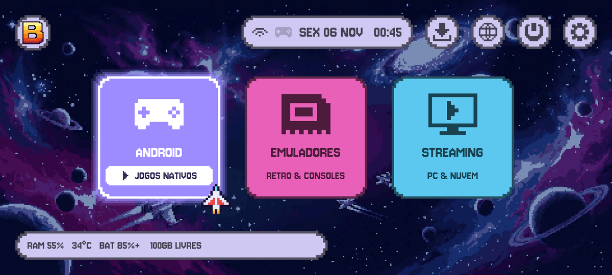
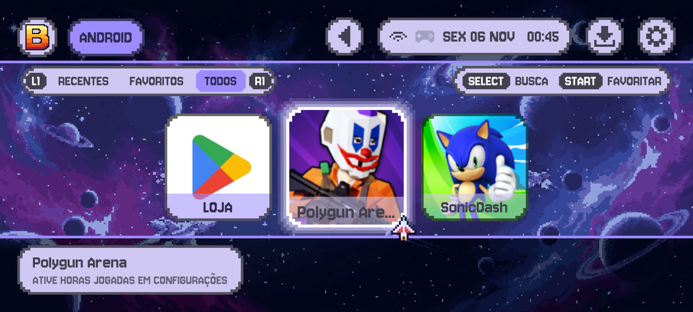
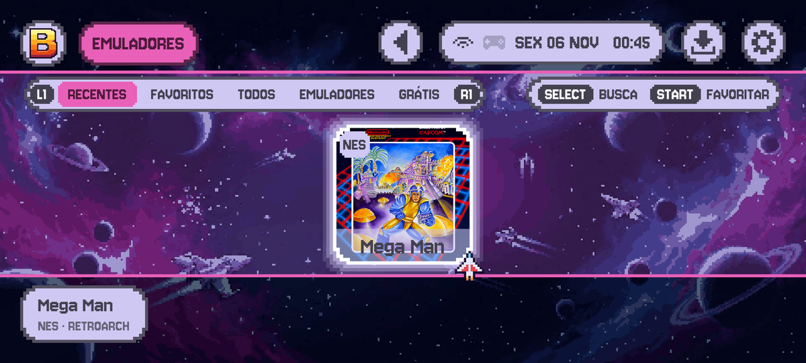
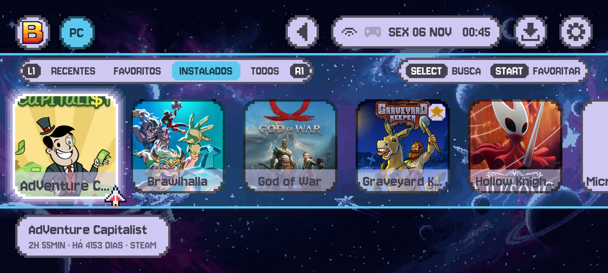

# BrickStation · Dungeon Dev Labs

**English** · [Português](#português)

Android launcher that turns your phone into a micro game console for the TV: Android games, retro emulators and your PC library, all played with a controller. The app code is private; this repo holds the guide, the PC extension and the public documents.

<p>
  
  
  
  
</p>

## What's here
| File | Purpose |
| --- | --- |
| [`assets/`](assets) | App screenshots |
| [`extension/`](extension) | BrickStation Link, the Playnite extension for the PC (DLL + `extension.yaml`) |
| [`privacy.md`](privacy.md) | Privacy policy (English), linked from the Play Store |
| [`privacidade.md`](privacidade.md) | Privacy policy (Portuguese) |
| [`DUNGEON.md`](DUNGEON.md) | Card data for the Dungeon Dev Labs home page |

## How to use
The launcher works alone for Android games and emulators. The PC part (steps 5 to 8) is optional.

### 1. Install and make it your launcher
1. Install BrickStation on the phone (Android 10 or newer).
2. Press Home and choose **BrickStation** as the default launcher (or *Settings → LAUNCHER PADRÃO* inside the app).

### 2. Connect a controller
Pair a Bluetooth controller in the Android settings (or *Settings → BLUETOOTH E CONTROLES* in the app). Use the D-pad to move, **A** to play, **B** to go back, **L1/R1** to change tab, **START** to favorite, **SELECT** to search, **Y** for info.

### 3. Put the game on the TV (optional)
Turn on Samsung DeX (wireless or HDMI). BrickStation detects the TV by itself: before a game, TV and phone show the same screen; during a game, the TV shows the game and the phone becomes a "now playing" screen. Check it in *Settings → TELA DA TV*.

### 4. Grant the permissions (in Settings)
| Setting | Why |
| --- | --- |
| **MENU DENTRO DO JOGO** (accessibility) | Guide button opens the quick menu over any game; reads controller buttons while a game has focus |
| **PERMITIR IMAGEM NA TV** (draw over apps) | Overlays on the TV |
| **HORAS JOGADAS** (usage access) | Play time per game |
| **TECLADO DO CONTROLE** | Type with the controller (R3 in a game). Needs one USB command, see below |

Optional, once, over USB (lets the app switch to the controller keyboard by itself, because DeX hides Android's keyboard picker):

```
adb shell pm grant com.dungeondevlabs.brickstation android.permission.WRITE_SECURE_SETTINGS
```

After reinstalling the app, turn the accessibility service off and on again.

### 5. Android games and emulators
- **JOGOS** lists your installed games. **APPS** lists the rest.
- **RETRO** shows your ROM folder by console. Pick the folder once; BrickStation opens each ROM in the right emulator (RetroArch, PPSSPP, melonDS, Dolphin, Flycast, Yaba Sanshiro 2, Azahar, NetherSX2, Vita3K, Eden). Missing emulators show an install link.
- In a game, the **Guide** button (or **START+SELECT**) opens the quick menu: settings, touch-control profiles, close game. **L3** moves a cursor, **R3** types.

### 6. Set up the PC (once)
1. Install [Playnite](https://playnite.link) and add your libraries (Steam, Epic, GOG, Xbox…). In *Settings → General* enable **Start with Windows** and **Start minimized**.
2. Close Playnite. Copy the [`extension/`](extension) files (`BrickStationLink.dll` and `extension.yaml`) to `%APPDATA%\Playnite\Extensions\BrickStationLink\` (portable Playnite: the `Extensions` folder next to it). Open Playnite again.
3. When Windows asks about the firewall, allow **private networks** (ports 47630 TCP and 47631 UDP). Set your home network as *Private*.
4. Test: `curl http://localhost:47630/status` shows the PC name and MAC.
5. Install [Sunshine](https://github.com/LizardByte/Sunshine/releases) in the default path, open `https://localhost:47990` and create a user. The **Desktop** app is already there.

### 7. Wake the PC from the phone (once)
1. BIOS/UEFI: enable **Wake on LAN**.
2. Windows, network adapter: *Advanced → Wake on Magic Packet = Enabled*; *Power Management → Allow this device to wake the computer*.
3. Turn off *Fast startup* and run `powercfg /h on` as administrator.

### 8. Phone: stream your PC
1. Install **Moonlight** and pair it with the PC (it shows a PIN to type in Sunshine). Open the PC once inside Moonlight.
2. In BrickStation open **STREAM**, choose your PC and type the PIN shown by Playnite.
3. From then on, selecting STREAM wakes the PC, loads your library as cards and opens the game you pick. Leaving the stream keeps the game running; opening another game asks to close it. **Desligar** hibernates the PC and closes everything.

## Rules / How to contribute
- Keep the English and Portuguese sections in sync.
- Do not commit anything but the files listed above. The extension DLL must come from a Release build.

## Privacy
[Privacy policy](privacy.md) · Google Play link soon

## Community
Found a bug or have a suggestion? Open an [Issue](../../issues) or write to luidy.moura.dev@gmail.com.

## AI
Built with AI dev copilots. Images generated by AI.

---

## Português

Launcher Android que transforma o celular em um microconsole para a TV: jogos Android, emuladores retrô e a biblioteca do seu PC, tudo com controle. O código do app é privado; este repo guarda o guia, a extensão do PC e os documentos públicos.

<p>
  
  
  
  
</p>

### O que tem aqui
| Arquivo | Para que serve |
| --- | --- |
| [`assets/`](assets) | Capturas de tela do app |
| [`extension/`](extension) | BrickStation Link, a extensão do Playnite para o PC (DLL + `extension.yaml`) |
| [`privacy.md`](privacy.md) | Política de privacidade (inglês), linkada na Play Store |
| [`privacidade.md`](privacidade.md) | Política de privacidade (português) |
| [`DUNGEON.md`](DUNGEON.md) | Dados do card na home da Dungeon Dev Labs |

### Como usar
O launcher funciona sozinho para jogos Android e emuladores. A parte do PC (passos 5 a 8) é opcional.

#### 1. Instale e deixe como launcher
1. Instale o BrickStation no celular (Android 10 ou mais novo).
2. Aperte Home e escolha **BrickStation** como launcher padrão (ou *CONFIG → LAUNCHER PADRÃO* no app).

#### 2. Conecte um controle
Pareie um controle Bluetooth nas configurações do Android (ou *CONFIG → BLUETOOTH E CONTROLES* no app). Direcional move, **A** joga, **B** volta, **L1/R1** troca a aba, **START** favorita, **SELECT** busca, **Y** mostra info.

#### 3. Jogue na TV (opcional)
Ligue a Samsung DeX (sem fio ou HDMI). O BrickStation acha a TV sozinho: antes do jogo, TV e celular mostram a mesma tela; durante o jogo, a TV mostra o jogo e o celular vira a tela "tocando agora". Confira em *CONFIG → TELA DA TV*.

#### 4. Libere as permissões (em CONFIG)
| Opção | Para que serve |
| --- | --- |
| **MENU DENTRO DO JOGO** (acessibilidade) | O botão Guia abre o menu rápido sobre qualquer jogo; lê os botões do controle com o jogo em foco |
| **PERMITIR IMAGEM NA TV** (sobrepor apps) | Painéis na TV |
| **HORAS JOGADAS** (acesso ao uso) | Tempo jogado por jogo |
| **TECLADO DO CONTROLE** | Digitar com o controle (R3 no jogo). Precisa de um comando por USB, veja abaixo |

Opcional, uma vez, por USB (deixa o app trocar para o teclado do controle sozinho, porque a DeX esconde o seletor de teclado do Android):

```
adb shell pm grant com.dungeondevlabs.brickstation android.permission.WRITE_SECURE_SETTINGS
```

Depois de reinstalar o app, desligue e ligue o serviço de acessibilidade de novo.

#### 5. Jogos Android e emuladores
- **JOGOS** lista seus jogos instalados. **APPS** lista o resto.
- **RETRO** mostra sua pasta de ROMs por console. Escolha a pasta uma vez; o BrickStation abre cada ROM no emulador certo (RetroArch, PPSSPP, melonDS, Dolphin, Flycast, Yaba Sanshiro 2, Azahar, NetherSX2, Vita3K, Eden). Emulador que falta mostra o link de instalação.
- Dentro do jogo, o botão **Guia** (ou **START+SELECT**) abre o menu rápido: configurações, perfis de controle por toque, fechar jogo. **L3** move um cursor, **R3** digita.

#### 6. Configure o PC (uma vez)
1. Instale o [Playnite](https://playnite.link) e conecte suas bibliotecas (Steam, Epic, GOG, Xbox…). Em *Configurações → Geral* marque **Iniciar com o Windows** e **Iniciar minimizado**.
2. Feche o Playnite. Copie os arquivos de [`extension/`](extension) (`BrickStationLink.dll` e `extension.yaml`) para `%APPDATA%\Playnite\Extensions\BrickStationLink\` (Playnite portátil: a pasta `Extensions` ao lado dele). Abra o Playnite de novo.
3. Quando o Windows perguntar sobre o firewall, permita em **redes privadas** (portas 47630 TCP e 47631 UDP). A rede de casa precisa estar como *Privada*.
4. Teste: `curl http://localhost:47630/status` mostra o nome e o MAC do PC.
5. Instale o [Sunshine](https://github.com/LizardByte/Sunshine/releases) no caminho padrão, abra `https://localhost:47990` e crie usuário e senha. O app **Desktop** já vem cadastrado.

#### 7. Ligar o PC pelo celular (uma vez)
1. BIOS/UEFI: ative **Wake on LAN**.
2. Windows, adaptador de rede: *Avançado → Wake on Magic Packet = Ativado*; *Gerenciamento de energia → Permitir que este dispositivo ative o computador*.
3. Desative a *Inicialização rápida* e rode `powercfg /h on` como administrador.

#### 8. Celular: transmita o PC
1. Instale o **Moonlight** e pareie com o PC (ele mostra um PIN para digitar no Sunshine). Abra o PC uma vez dentro do Moonlight.
2. No BrickStation abra **STREAM**, escolha o PC e digite o PIN que aparece no Playnite.
3. Depois disso, escolher STREAM liga o PC, carrega sua biblioteca em cards e abre o jogo escolhido. Sair da transmissão mantém o jogo rodando; abrir outro jogo pergunta se fecha o anterior. **Desligar** hiberna o PC e fecha tudo.

### Regras / Como contribuir
- Mantenha as seções em inglês e português iguais.
- Não suba nada além dos arquivos listados acima. A DLL da extensão deve vir de um build Release.

### Privacidade
[Política de privacidade](privacidade.md) · link da Google Play em breve

### Comunidade
Achou um bug ou tem uma sugestão? Abra uma [Issue](../../issues) ou escreva para luidy.moura.dev@gmail.com.

### IA
Feito com copilotos de IA no desenvolvimento. Imagens geradas por IA.
